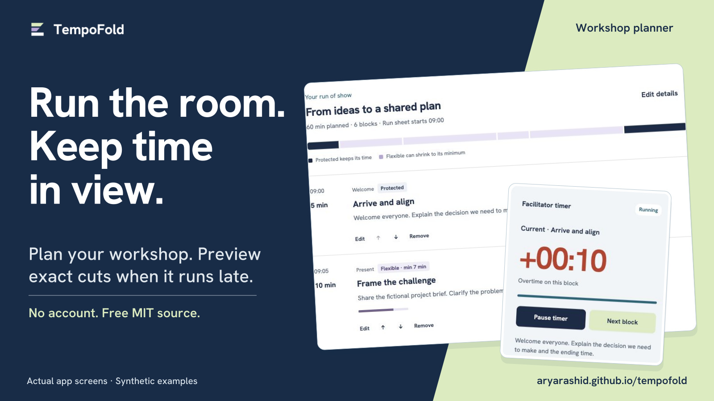
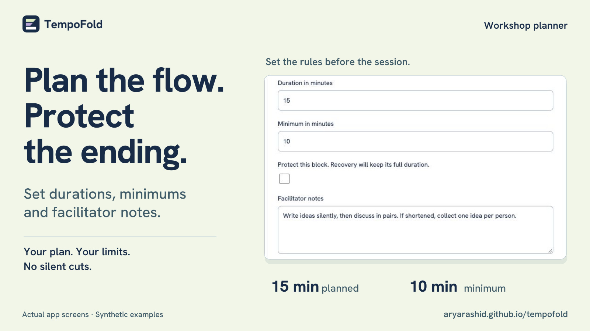
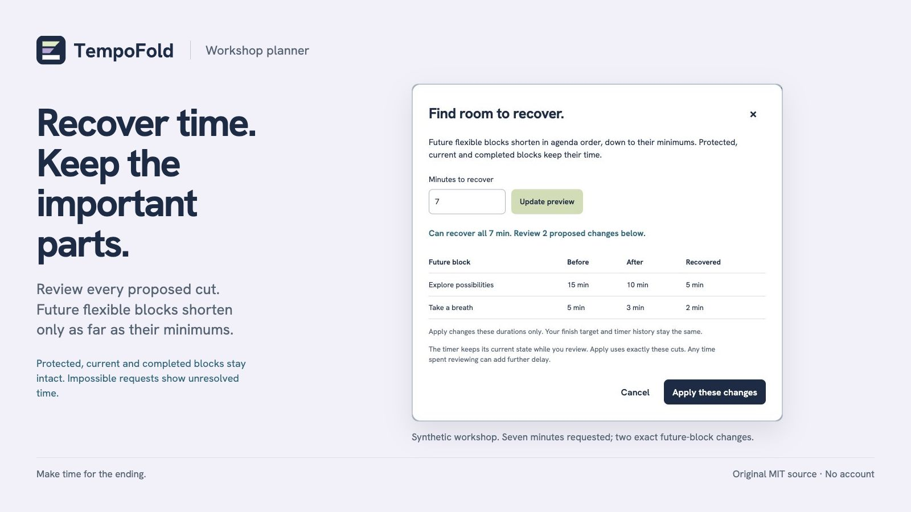
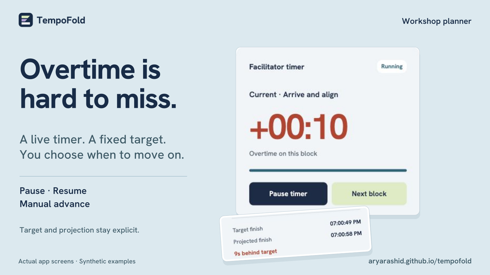
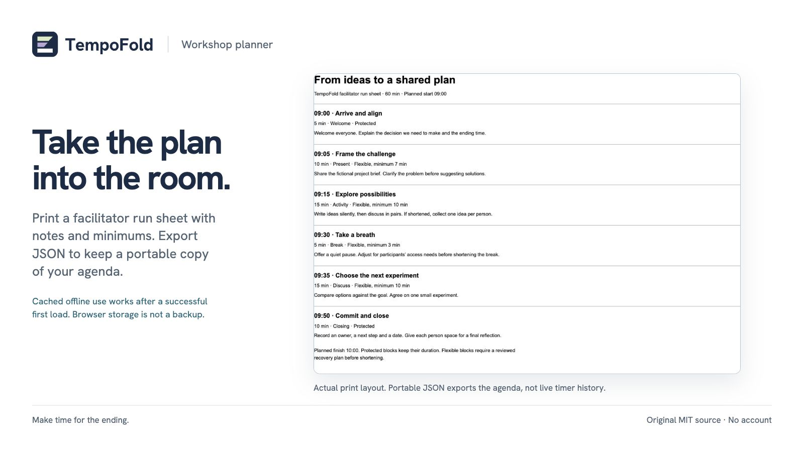
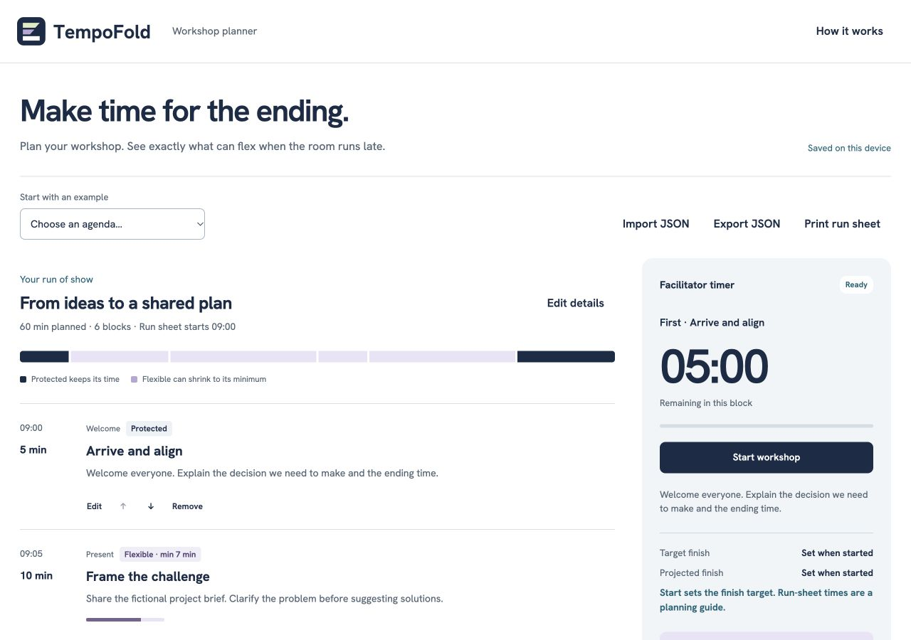

<p align="center">
  <picture>
    <source media="(prefers-color-scheme: dark)" srcset="./brand/wordmark-reversed.svg">
    
  </picture>
</p>

<h1 align="center">Make time for the ending.</h1>

<p align="center">Plan your workshop. See exactly what can flex when the room runs late.</p>

<p align="center">
  <a href="https://aryarashid.github.io/tempofold/">Try the live planner</a> ·
  <a href="#quickstart">Run locally</a> ·
  <a href="#screenshots">See the product</a> ·
  <a href="./docs/usage.md">User guide</a>
</p>



**TempoFold is a small workshop planner and facilitator timer for one device.** Set durations, minimums and protected blocks, then preview exact cuts to future flexible blocks before applying them. No block changes without your approval.

Original software by [Arya Rashid](https://github.com/aryarashid), built with AI assistance. **Free MIT source, no account, no backend and no npm runtime dependencies.** Workshop data stays in your browser; there are no analytics or cloud uploads. All examples and screenshots use synthetic content.

## What you can do

- **Plan the flow.** Edit blocks, categories, facilitator notes, durations and minimums; reorder with explicit controls.
- **Protect important time.** Keep a welcome, accessibility break or closing at its full duration by marking it protected.
- **Recover time visibly.** Review each proposed before-and-after cut and any time that cannot be recovered. Apply or cancel, with one recovery undo snapshot.
- **Run the room.** Pause, resume and advance the timer yourself. Target and projected finish remain visible; saved timestamps survive a reload.
- **Take the plan with you.** Import or export validated JSON and print a facilitator run sheet with notes, minimums and protected status.
- **Prepare for offline use.** After the first successful load and cache installation, the app can reload offline. Check its offline status before disconnecting.

## Quickstart

The [hosted planner](https://aryarashid.github.io/tempofold/) is ready to use without installation. For a local copy, install **Node.js 22 or later** and Git:

```sh
git clone https://github.com/aryarashid/tempofold.git
cd tempofold
npm ci
npm start
```

Open **http://127.0.0.1:4173**. There is no build step. The server binds only to this computer; use `PORT=4174 npm start` for another port. A public static deployment needs HTTPS for service workers. Opening `index.html` directly from disk does not support module loading or offline caching.

### Try a complete workflow

1. Choose **60-minute workshop** to load the synthetic agenda, From ideas to a shared plan.
2. Inspect block durations, minimums and protected time. Before starting, preview a **7-minute recovery**: Frame the challenge changes from 10 to 7 minutes, and Explore possibilities from 15 to 11. The protected closing keeps all 10 minutes.
3. Apply the preview to make a 53-minute agenda, then Undo to restore 60 minutes.
4. Start the workshop, pause or advance manually, and export JSON or print the run sheet.

During a running session, recovery only considers future flexible blocks. Current, completed and protected blocks keep their duration. The [user guide](./docs/usage.md) explains timer targets, pauses, undo, imports and storage recovery in detail.

### Included examples

Choose these in the app, or download the JSON and import it:

| Example | Duration | Useful for |
| --- | --- | --- |
| [From ideas to a shared plan](./examples/workshop.json) | 60 minutes | Workshop planning and exact recovery previews |
| [Product demo](./examples/product-demo.json) | 12 minutes | A short, timed rehearsal |
| [Community listening session](./examples/community-session.json) | 45 minutes | Facilitated discussion with protected opening and closing |

These are fictional starting points, not tested facilitation methods or customer results.

## Screenshots

Actual app screens appear in each composition below. Click an image to inspect it at full size. All agenda content is synthetic.

| Plan and protect | Preview exact cuts |
| --- | --- |
| [](./marketplace/images/03-planning.jpg) | [](./marketplace/images/02-recovery.jpg) |
| **Run a timed session** | **Print a run sheet** |
| [](./marketplace/images/04-timer.jpg) | [](./marketplace/images/05-run-sheet.jpg) |

<details>
<summary>View the full planner screenshot</summary>



</details>

[Browse all nine product and social images](https://aryarashid.github.io/tempofold/marketplace/) · [View the brand kit](./brand/README.md) · [Download the complete promotional kit](https://github.com/aryarashid/tempofold/releases/download/marketing-kit-v1/tempofold-promotional-kit-v1.zip)

## Privacy and practical limits

Use **one tab on one device per workshop**. There is no collaboration, cloud sync, calendar integration, audio alarm, broadcast output or remote control. The facilitator decides what can shorten and approves every recovery.

Local storage is convenient, not a backup. Export JSON before clearing browser data or replacing an agenda. Private browsing and storage restrictions can prevent saving. Offline use requires a successful first load and cache installation, and browsers may evict caches.

The timer uses the device clock. Running time includes device sleep; pause stops the block timer while the finish target stays fixed, so pausing can create delay. Blocks never advance automatically. Export contains the agenda, not live timer history.

Imports allow 1–100 blocks, up to 24 hours total, four hours per block and 512 KB of UTF-8 JSON. Invalid imports leave current work untouched. [Read the full behavior and limits](./docs/usage.md).

Keyboard users can reach actions with Tab and activate buttons with Enter or Space; Escape closes dialogs. Status labels supplement color, and the timer does not announce every second. Mobile and keyboard checks are documented in [verification](./docs/verification.md); no independent assistive-technology audit is claimed.

## Develop and contribute

```sh
npm run check
```

This runs JavaScript syntax checks and the focused Node test suite. It does not install a browser or run a build. The [verification record](./docs/verification.md) separates automated checks from browser, mobile, print and offline checks.

Start with the [contribution guide](./CONTRIBUTING.md), [architecture and deployment notes](./docs/architecture.md), or [user guide](./docs/usage.md). The app is plain HTML, CSS and JavaScript; `src/core.js` holds validation, timing and recovery logic, while `src/app.js` connects it to the browser.

For a reproducible bug or usage question, [open a GitHub issue](https://github.com/aryarashid/tempofold/issues). Use synthetic examples and omit private workshop content. Support is community-based, with no response-time promise, paid support or maintenance agreement. See [support guidance](./CONTRIBUTING.md#support-and-security).

## Background and alternatives

The focus is transparent, constrained recovery in a small browser app. Demand evidence is moderate and does not establish market size or willingness to pay. Facilitators discuss overtime in the [Ontime community](https://github.com/cpvalente/ontime/discussions/1791), while the [Collaborative Modeling Workshop Preparation Canvas](https://github.com/ddd-crew/como-prep-canvas) covers workshop preparation. These informed problem selection only; no code, text, canvas, design or assets were copied.

[Ontime](https://www.getontime.no/) offers a larger open-source event timing system. [SessionLab](https://www.sessionlab.com/) provides a broader workshop planner. TempoFold does not claim to invent event timers or replace those tools.

## License and distribution

Original source, examples and artwork use the [MIT license](./LICENSE). You can use, modify, distribute and sell copies subject to its notice requirements. **No purchase is required to use this repository or the hosted planner.** The separately listed [Zero to Hundred offer](https://zerotohundred.ai/listings/tempofold-sbp9lh) is priced at $10 and has its own transaction terms; it is not required for access to the MIT source.

The bundled Hanken Grotesk font and outlined wordmark lettering retain **SIL Open Font License 1.1**. Keep [THIRD_PARTY_NOTICES.md](./THIRD_PARTY_NOTICES.md) and the [font license](./assets/fonts/OFL.txt) with redistributed files. There are no npm runtime dependencies or copied templates. Optional promotional authoring tools are documented separately in the [promotional kit](./marketplace/README.md).
