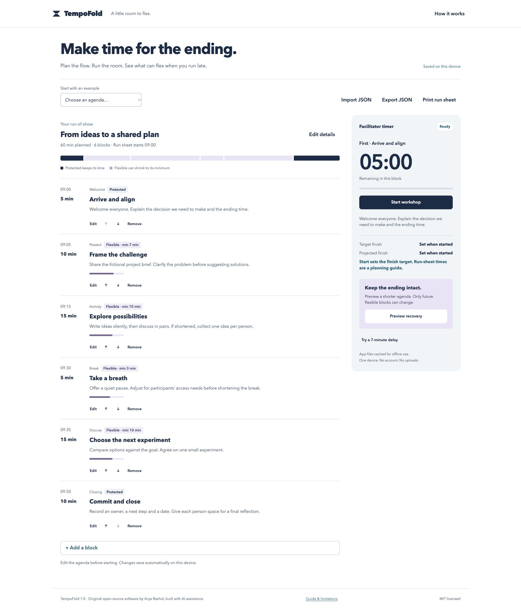
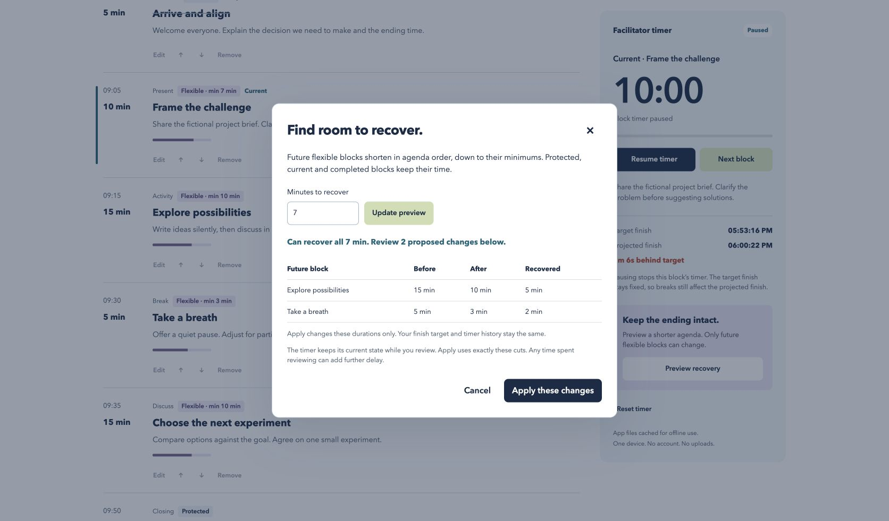

# TempoFold

Plan and run a workshop on one device. When it runs late, preview exactly which future blocks can shorten while protected blocks keep their time.

TempoFold is original MIT-licensed software by Arya Rashid, built with AI assistance. It has no runtime dependencies, account, backend, paid API, analytics or cloud uploads. All examples are synthetic.

[Open the live demo](https://aryarashid.github.io/tempofold/) or [browse the source](https://github.com/aryarashid/tempofold).





## Run it

Install Node.js 22 or later, then run:

```sh
npm ci
npm start
```

Open `http://127.0.0.1:4173`. No build step is required. Run `npm run check` for syntax checks and the Node test suite. To use another port, set `PORT=4174 npm start`. The development server binds to this computer only. Serve the static files over HTTPS for a public deployment. Service workers require HTTPS or localhost. Opening `index.html` directly from disk does not support module loading or offline caching.

## Use it

Choose a synthetic example or a blank agenda. Edit block titles, categories, durations, minimums and facilitator notes. Move blocks with the up and down buttons. Protect any block that must keep its full duration. The run-sheet start time labels the printable plan. It does not schedule the live timer.

Start workshop sets the target finish to the current time plus the total agenda duration. The timer never advances a block automatically. Next block records actual elapsed time and starts the next block. Finish workshop records the finish time. Pausing stops the block timer while the finish target stays fixed. A pause can therefore create delay. Timers use saved timestamps instead of counting animation frames, so background tabs and reload do not restart them. Device sleep counts as elapsed time when running. Keep the system clock accurate.

Preview recovery accepts a requested number of minutes and allocates cuts in agenda order. Only future flexible blocks are eligible during a session. Before a session, all flexible blocks are eligible. Each cut stops at that block's minimum. The preview lists exact before and after durations and any unresolved time. Apply uses those exact cuts. Time spent reviewing can create further delay. Nothing silently shrinks the current, completed or protected blocks.

Undo restores the agenda before the last recovery, including notes and metadata. Undo remains available across a reload until you advance to the next block, edit the agenda, replace it or reset the timer. Reset timer clears live history and keeps current agenda durations, including recovery changes. Export first if you want to preserve a separate plan.

Import and export use versioned JSON. Import a file or paste its contents into the import dialog. Export includes the agenda only, not the live timer or its history. Import validates the whole file before asking to replace current work. Invalid imports leave current work untouched. Import permits 1 to 100 blocks, a total duration up to 24 hours, at most four hours per block, and a 512 KB UTF-8 file. Titles and notes render as text. Unknown fields, duplicate IDs, unsupported categories and invalid durations fail validation. Find portable originals in [examples](./examples).

Print run sheet uses the current agenda and its planning start time. Notes, categories, protected status and minimums appear in the print layout. It does not print live history or a dynamically projected schedule.

## Privacy, offline use and limitations

The browser's local storage holds the current agenda, timer and one recovery undo snapshot. Export JSON for a backup. Private browsing, storage restrictions or cleared browser data can prevent saving. The app reports save failures. Corrupt saved data is retained until you explicitly replace it; download that data before doing so. Use one tab per workshop. A second tab changing saved data pauses writes in this tab to avoid overwriting the other tab's work.

After the first successful load and service-worker installation, app files cache for offline use. Check the offline status under the timer before disconnecting. A first visit requires a connection. Offline caching does not back up your agenda. Updates activate after existing tabs close, preserving one consistent cached version during a session. Browsers may evict caches. See [verification](./docs/verification.md) for tested environments and limits.

This is a single-device planning and rehearsal tool. There is no collaboration, cloud sync, calendar integration, audio alert, broadcast output, multi-device clock synchronization, AI generation or remote control. It does not choose which ideas are expendable or decide whether an accessibility break can be shortened. The facilitator sets minimums and approves every change. For longer sessions the timer displays hours. Agenda times that cross midnight display +1 day. Timing uses the device clock, not a trusted network clock.

Keyboard users can reach every action with Tab and activate buttons with Enter or Space. Escape closes dialogs. The timer does not announce every second to screen readers. Protected, flexible, paused, overtime and completed states have text labels in addition to color. There are no global keyboard shortcuts that interrupt note entry.

## Background and alternatives

The project focuses on transparent constrained recovery in a small offline browser app. Demand evidence is moderate and does not establish market size or willingness to pay. Facilitators discuss how to manage overtime in the [Ontime community](https://github.com/cpvalente/ontime/discussions/1791). The [Collaborative Modeling Workshop Preparation Canvas](https://github.com/ddd-crew/como-prep-canvas) discusses workshop preparation. Those sources informed the problem selection only. TempoFold does not reproduce their code, text, canvas, design or assets.

[Ontime](https://www.getontime.no/) is a larger open-source event timing system with projected timings and production-oriented workflows. [SessionLab](https://www.sessionlab.com/) offers a broader workshop planner with automatic timings and time locks. TempoFold does not claim to invent event timers or replace those tools.

## License and contributions

Original source, examples and icon use the [MIT license](./LICENSE). There are no bundled third-party packages, fonts, images or copied templates. See [THIRD_PARTY_NOTICES.md](./THIRD_PARTY_NOTICES.md). The lockfile records the zero-dependency project. No GPL Ontime code or CC-BY-SA canvas material is included.

Contributions should include a behavior test for timing, recovery or import changes. Keep original work and its notices attributable. Do not add telemetry or cloud services without an explicit product decision. Report security issues privately to the repository owner before publishing sensitive details.
